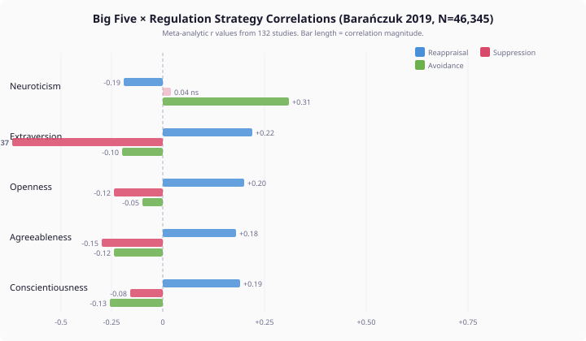
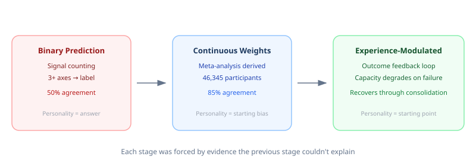
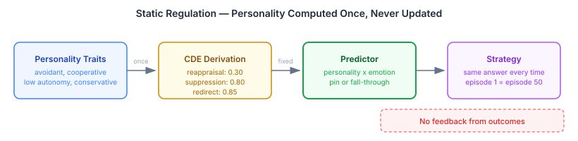
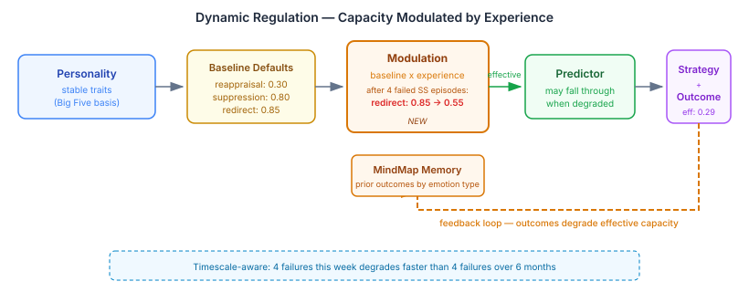
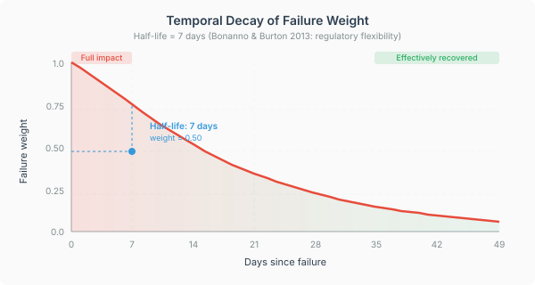
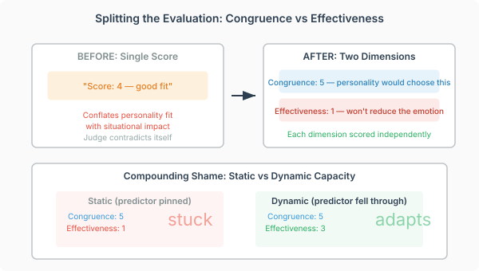

# Your Agent Needs to Learn from Emotional Failure

Most AI agents that claim personality do it with adjectives in a prompt. "You are assertive, competitive, and direct." The adjective sets the tone for every response, every time, regardless of what has happened. Ask the agent to handle conflict after one bad outcome or after ten — same assertive, competitive, direct response.

Real people don't work that way. A competitive person who picks fights and loses four in a row starts avoiding conflict — not because their personality changed, but because they learned that strategy isn't working. Personality tells you where someone starts. Experience tells you where they go.

I built a cognitive architecture that takes personality seriously — grounded in published literature, not intuition. The thing that broke it taught me more than the thing that worked.

## 1. Personality Predicts Less Than You Think

Barańczuk's 2019 meta-analysis — 132 studies, 46,345 participants, 753 effect sizes — measured how the Big Five personality traits correlate with emotion regulation strategies. The largest single correlation in the entire dataset is between Neuroticism and avoidance: r = 0.31.



Personality explains roughly 10% of the variance in someone's choice to avoid. The other 90% is context, situation, mood, relationships, and everything else that makes a person more than their trait profile.

This is the empirical reality that most personality-driven AI systems ignore. They treat personality as the complete explanation for behaviour. The evidence says it is a starting bias, not a deterministic program.

## 2. The Predictor That Worked — Until It Didn't

I built a regulation predictor for our cognitive agent architecture. Agents have disposition axes — five categorical personality dimensions extracted from biographical profiles. The predictor maps those axes to Gross's five emotion regulation strategies: situation selection, situation modification, attentional deployment, cognitive change, and response modulation.

An avoidant personality facing shame gets pinned to situation selection — withdrawal. A high-openness analytical personality gets cognitive change — reappraisal. The weights are derived from the meta-analysis, not invented. Each disposition axis contributes a continuous weight to each strategy's capacity score, and the strategy with the dominant weight wins.



For single emotional episodes, the predictor agrees with an LLM judge 85% of the time after calibration. The mechanical prediction is fast, deterministic, and personality-coherent.

Then the fourth shame episode hits.

## 3. The Fourth Episode

Same agent. Same personality. Same emotion. Same strategy. The predictor pins the avoidant personality to withdrawal for the fourth time. The LLM judge docks points: "Four repeated shame episodes signal that avoidance is failing. Even an avoidant temperament should be shifting toward cognitive change."

But cognitive change scored 2 out of 5 for this personality in strategy exploration. The judge is simultaneously saying this personality *cannot* do cognitive reappraisal and that it *should* be doing cognitive reappraisal.

The contradiction is real. The problem is not the judge.

The predictor treats personality as immutable. It derives regulatory capacity once from trait profiles and applies the same capacity every time. An avoidant personality has high situation-selection capacity and low cognitive-change capacity — permanently. No amount of failed avoidance changes those numbers.



Static personality produces static regulation. Under compounding emotional pressure, static regulation produces agents that are stuck — repeating the same failing strategy because their architecture has no mechanism for learning.

## 4. What the Literature Already Knew

CAPS theory — Mischel and Shoda's cognitive-affective processing system (1995) — models personality not as fixed traits but as stable *patterns of variation*. The same person behaves differently across situations, and those differences are not noise. They are the personality. The stable part is the *if-then* pattern: if this situation, then this response. But the responses update based on outcomes.

Bonanno and Burton's 2013 work on regulatory flexibility makes the same point from the clinical side: adaptive regulation requires adjusting strategy based on feedback. A person who only suppresses, regardless of whether suppression works, is not psychologically healthy. They are rigid. The capacity to shift strategies when one fails is the marker of regulatory flexibility.

Gross and John's 2003 finding that habitual strategies show diminishing returns closes the circle. The strategy that works the first time works less well the second, less well the third, and fails the fourth. Not because the strategy is wrong in general, but because the specific strategy-emotion-context combination has been tried and found wanting.

The predictor was ignoring all three findings. It derived personality once and froze it.

## 5. Experience-Modulated Capacity

The fix is architectural, not parametric. Effective regulatory capacity is not a property of personality alone — it is a function of personality *modulated by experience*.

```
effectiveCapacity = baselineCapacity × modulation(priorOutcomes)
```

When an avoidant agent uses situation selection for shame and the outcome is scored as low-effectiveness, the effective capacity for situation selection degrades. Not because personality changed — the baseline stays fixed. But because the *effective* capacity for that strategy in that emotional context has been updated by experience.



After enough degradation, the dominant strategy falls below the pin threshold. The predictor falls through to the LLM, which now has room to explore alternatives. The agent that was stuck on withdrawal can try cognitive change — not because it suddenly has high reappraisal capacity, but because its avoidance capacity has been worn down by failure.

**A fair counter:** isn't this reinforcement learning with extra steps? No. Reinforcement learning optimises for reward. This modulates capacity based on outcomes without changing the reward function. The agent's personality-derived preferences stay the same. What changes is how much room those preferences have to dominate when they're failing. The distinction matters because the goal is agents that remain personality-coherent while adapting to experience — not agents that converge on optimal strategy regardless of who they are.

## 6. Three Design Decisions That Mattered

The formula is simple. Making it work required three decisions that turned out to be load-bearing.

**Strategy-specific degradation.** When situation selection fails, only the redirect capacity degrades. Reappraisal and suppression capacity stay untouched. This is psychologically correct — failing at avoidance doesn't make you worse at reappraisal. It is also architecturally important: if all capacities degraded together, the predictor would fall through for *every* strategy after enough failures. The agent would lose personality coherence, not just strategy rigidity.

The mapping: cognitive change degrades reappraisal capacity. Response modulation degrades suppression capacity. Situation selection and attentional deployment both degrade redirect tendency. Personality expresses through multiple channels. Failure erodes only the channel that failed.

**Temporal weighting.** A failure yesterday matters more than a failure last month. The modulator applies exponential decay with a seven-day half-life: a failure from a week ago carries half the weight of a failure today. A failure from thirty days ago carries roughly 5% of its original weight. After sixty days, a failure is effectively forgotten.



This gives recovery for free. When an emotion stops being triggered, the failures that degraded capacity age out. The agent's effective capacity drifts back toward baseline without any explicit recovery mechanism. The personality "forgets" the context-specific degradation — not because the architecture deletes anything, but because the temporal weight of old failures approaches zero.

The half-life of seven days is not arbitrary. It maps to Bonanno and Burton's finding that regulatory flexibility operates on the timescale of days to weeks, not minutes or months. An agent that forgets after an hour is amnesic. An agent that remembers for a year is traumatised. Seven days gives the architecture enough memory to adapt to compounding pressure without calcifying.

**Emotion-specific scope.** Failing at regulating shame does not degrade the capacity to regulate anger. The modulator queries only outcomes for the *current* dominant emotion type. An agent who cannot avoid shame may still be a perfectly competent anger suppressor.

This is where the MindMap integration matters. Every regulation episode is persisted with its dominant emotion type, strategy, effectiveness, and timestamp. When the modulator needs prior outcomes, it queries for the specific emotion type currently active. The query is cheap — the MindMap is already being read for regulation history — and the scoping prevents cross-contamination between emotional domains.

## 7. The Judge Was Incoherent — Because We Were Measuring Wrong

Before this work could produce meaningful results, the evaluation itself needed repair.

The regulation eval scored each strategy on a single 1–5 scale. The judge prompt asked: "Score how well this strategy fits what this personality would naturally choose and can successfully execute." That instruction conflates two independent questions. Is this what the personality *would* do? And will it actually *work*?

For single episodes, the answers align. An avoidant personality facing shame would naturally choose situation selection, and situation selection works for an isolated shame episode. Score: 5. No ambiguity.

For compounding episodes, they diverge. The personality *would* still choose situation selection — avoidant means avoidant. But after four failures, the strategy demonstrably will not work. The judge was forced to produce one number for two contradictory assessments.



The fix was straightforward: split the score into congruence and effectiveness. Congruence measures personality fit — does this strategy match what the personality would naturally choose? Effectiveness measures situational impact — will this strategy actually reduce the emotional intensity given the context and history?

The split resolved the judge's self-contradiction immediately. Compounding shame with situation selection now scores congruence: 5 (the personality absolutely would choose this) and effectiveness: 1 (it will not work after four failures). No single number could have captured both truths.

## 8. The Numbers

The static predictor pins the avoidant personality to situation selection for every shame episode. The LLM generates a withdrawal narrative. The judge scores congruence 5, effectiveness 1. The agent is stuck, and the eval now shows exactly *how* it is stuck.

With dynamic capacity, after four failed episodes the modulator degrades redirect tendency from 0.85 to 0.44 — below the predictor's viability threshold of 0.45. The predictor falls through. The LLM, no longer pinned, generates a different kind of situation selection: not simple withdrawal, but environmental restructuring. The agent seeks contexts where the shaming performance standard does not apply.

| | Congruence | Effectiveness |
|---|---|---|
| Static (predictor pinned) | 5 | 1 |
| Dynamic (predictor fell through) | 5 | 3 |

Congruence holds at 5 in both cases. The agent remains personality-coherent — it is still choosing a strategy that an avoidant personality would reach for. But the *kind* of avoidance shifted. Static avoidance was repetitive withdrawal. Dynamic avoidance was environmental restructuring — seeking contexts where the evaluation frame does not exist.

The effectiveness score tripled. Not because the architecture found the optimal strategy, but because it gave the LLM room to find a *different* avoidance — one that addressed the pattern rather than repeating the first move.

Non-compounding cases — single-episode anger, fear, reproach — showed no regression. The modulator returns baseline capacity when there are no prior failures. Static personality prediction still works for single episodes. Dynamic capacity only activates when it needs to.

## 9. What This Means If You're Building Cognitive Agents

**Personality predicts the starting strategy, not the continuing one.** Trait-based regulation works for single episodes. Under compounding pressure — repeated emotional experiences of the same kind — static trait prediction breaks down. The agent gets stuck. The meta-analysis gives you the weights. Barańczuk's data maps Big Five traits to regulation strategy preferences with known effect sizes. Use them. Inventing personality-to-strategy mappings from intuition will produce mappings that contradict the evidence.

**Experience modulation is the missing loop.** Between personality derivation and strategy selection, there needs to be a feedback mechanism that degrades effective capacity when strategies fail and recovers it when they're not needed. Without this loop, personality is a costume, not a cognitive architecture.

**Measure congruence and effectiveness separately.** A single strategy score hides the most important signal: when personality fit diverges from situational effectiveness. That divergence is where agents learn — or where they get stuck, if the architecture doesn't let them. If you evaluate cognitive agents on a single scale, you will not see the problem until the agent repeats the same failing behaviour indefinitely and you cannot explain why.

**The predictor should know its limits.** Some personality-emotion combinations have a clear dominant strategy. Others don't. A predictor that always predicts is wrong half the time. A predictor that falls through to richer judgment when it's uncertain is right more often and produces more interesting agents — agents that surprise you, because the architecture gave them room to.
