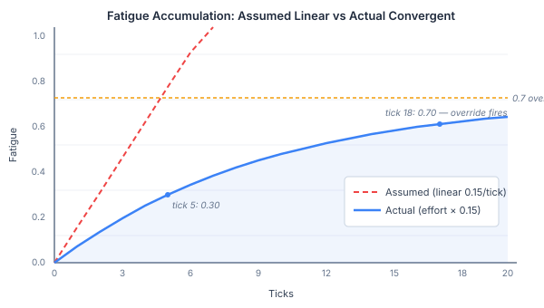
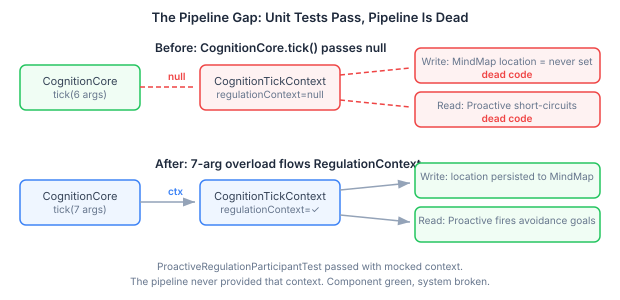
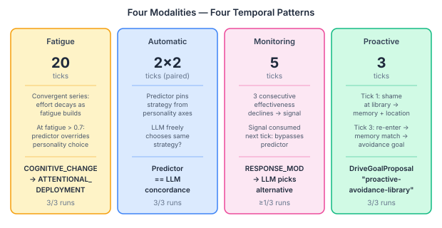

# The Test That Broke the Math

We built four regulation modalities into our cognitive agent architecture: fatigue that degrades willpower, a predictor that pins strategies from personality, a monitor that detects declining effectiveness, and proactive avoidance that remembers where shame happened. Each modality had unit tests. Each passed. The architecture was clean, the components well-separated, the literature citations solid.

Then we wrote the eval tests — multi-tick scenarios that run the full pipeline — and found that the spec's arithmetic was wrong, two modalities were dead code in the production pipeline, and the most interesting behaviour came from an interaction nobody designed.

This is a post about what happens when you test temporal behaviours in cognitive agents. Not "does the function return the right value" but "does the system change over twenty ticks the way the theory says it should." The findings are specific to our architecture, but the lessons apply to anyone building agents that are supposed to change over time.

## The Convergent Series Nobody Checked

The fatigue model comes from Bosse, Pontier, and Treur (2010). Every tick that an agent regulates emotion, fatigue accumulates. Eventually fatigue overwhelms the agent's willpower and regulation fails — the emotion breaks through. The spec said this should happen around tick 5.

The formula is simple: `fatigue_increment = effort × 0.15`. The spec assumed effort was constant, giving linear accumulation: 0.15 per tick, crossing the 0.70 override threshold by tick 5.

Effort is not constant.

Effort depends on alpha — the agent's willingness to regulate — which depends on fatigue:

```
alpha = baseline × (1.0 - currentFatigue)
effort = alpha × discrepancy / D_MAX
```

As fatigue grows, alpha shrinks. As alpha shrinks, effort shrinks. As effort shrinks, fatigue grows slower. This is a negative feedback loop — a convergent geometric series. Each tick's fatigue increment is smaller than the last.



At tick 5, the assumed model predicts fatigue of 0.75. The actual model produces 0.30. The spec was off by a factor of 2.5 at five ticks, and the gap widens: the actual model asymptotically approaches but never reaches 1.0.

The override threshold — the point where fatigue is high enough that the predictor forces a strategy change — sits at 0.70. The assumed model crosses it at tick 5. The actual model crosses it around tick 18-20. Not wrong as a concept, just wrong as a timeline.

This is the kind of error that survives design review, passes code review, and fails at runtime. The formula is correct. The implementation is correct. The spec's mental model of the formula is wrong. The only thing that catches it is running the numbers — either pen-and-paper arithmetic or, better, a test that runs the actual pipeline for twenty ticks and observes where the transition happens.

We found it by running the arithmetic before writing the test. If we had written the 5-tick test first, it would have failed, and we would have assumed the implementation was buggy rather than the spec.

## The Gap the Unit Tests Couldn't See

Proactive regulation is the system's ability to avoid situations based on emotional memory. The agent was humiliated in the library last time — so this time, before it even enters, it generates an avoidance goal. The mechanism has three parts: the reactive regulation system writes regulation results to memory with location context, the proactive participant reads that memory and checks for matches, and personality determines how strongly the agent avoids.

Every component had unit tests. The proactive participant's test manually constructed a `RegulationContext` with location data and verified that avoidance goals were produced. The reactive regulation's test verified that results were written to memory. Both passed.

The eval test failed. Zero avoidance goals, three runs.



The problem was in `CognitionCore.tick()` — the single method that orchestrates the full cognitive pipeline. It constructs a `CognitionTickContext` using a 7-argument constructor that passes `null` for `regulationContext`. Always. On every tick. The 8-argument constructor that accepts a `RegulationContext` existed — it just was never called.

This created a two-directional gap. The write path: reactive regulation writes results to memory using `context.regulationContext()`, which is always null, so location data is never persisted. The read path: the proactive participant checks `regulationContext` on entry and short-circuits when it is null — so it never queries memory.

Both components work perfectly in isolation. The unit tests prove this. The proactive test mocks the context; the reactive test doesn't check what gets written to the memory store. Neither test exercises the pipeline that connects them. The gap lives in the wiring layer that neither component owns.

The fix was one new method — a 7-argument `tick()` overload that accepts `RegulationContext` and passes it to the 8-argument context constructor. The existing overloads delegate to it with null. Twelve lines of code. The proactive eval test went from 0/3 to 3/3.

This is not an obscure integration bug. This is the most common failure mode in component-oriented architectures: every component works, the tests prove it, and the pipeline that connects them has a null where data should flow. The only way to catch it is a test that runs the full pipeline with realistic inputs and asserts on system-level outcomes.

## The Behaviour Nobody Designed

The monitoring system tracks regulation effectiveness across ticks. When the same strategy is used three times with declining effectiveness, it generates a failure signal. The next tick consumes the signal, bypasses the predictor, and lets the LLM freely choose an alternative strategy.

We expected the monitoring test to be hard — effectiveness comes from the LLM and cannot be forced to decline. The observations escalate in intensity across five ticks to give the LLM reason to reduce effectiveness, but there is no guarantee.

The fatigue test told us something unexpected. In runs where fatigue accumulated over twenty ticks, the strategy transition to ATTENTIONAL_DEPLOYMENT happened around tick 5 — far earlier than the predictor's fatigue threshold of 0.70.

The cause: the LLM was responding to the fatigue signal in its prompt. When the generation phase includes "Regulation fatigue: 30% — repeated regulation is depleting capacity," the LLM generates lower effectiveness scores. After three ticks of LLM-generated declining effectiveness, the monitor fires a failure signal. The predictor is bypassed. A different strategy is selected.

Fatigue and monitoring were designed as independent systems. Fatigue tracks willpower depletion; monitoring tracks strategy effectiveness. They were implemented in separate classes with no coupling. But the LLM — which receives both fatigue and effectiveness history as prompt context — creates a coupling that neither design document anticipated.

The fatigue prompt tells the LLM the agent is getting tired. The LLM responds by generating lower effectiveness. Lower effectiveness triggers the monitor. The monitor triggers a strategy switch. The switch happens fifteen ticks earlier than the fatigue threshold alone would produce.

This is emergent behaviour in the literal sense: a system-level pattern that arises from component interactions and is not present in any single component's specification. It is also the right behaviour. An agent under sustained emotional pressure should adapt faster than the mechanical fatigue threshold dictates, because the LLM's judgment about declining effectiveness is a better signal than a fixed numerical threshold.

We did not design this. The eval test surfaced it.

## What Multi-Tick Eval Actually Tests



Single-tick tests tell you whether a function returns the right value for a given input. Multi-tick tests tell you whether a system changes over time the way a theory says it should. The distinction matters because temporal behaviours are where cognitive architectures diverge from simple prompt engineering.

A prompted agent has no fatigue. Ask it to suppress anger ten times and it suppresses anger ten times, each time as effectively as the first. A cognitive architecture with fatigue accumulation, monitoring feedback, and personality-modulated thresholds produces an agent that suppresses anger three times, then switches to cognitive change on the fourth because the monitor detected declining effectiveness, then falls back to attentional deployment on the fifteenth because fatigue accumulated past the override threshold.

That trajectory — suppress, suppress, suppress, change, change, override — is the personality made visible over time. It is also the thing that no unit test can verify, because it only exists across the full sequence of ticks running through the full pipeline.

Four practical points for anyone building temporal cognitive behaviours:

**Run the arithmetic.** If a spec says "threshold crossed by tick N," compute the trajectory manually before writing the test. Negative feedback loops, decay functions, and convergent series produce timelines that are counterintuitive. The formula can be correct and the spec can still be wrong about what the formula produces.

**Test the pipeline, not the components.** Component tests with mocks prove that each piece works in isolation. They do not prove that data flows between pieces. The most common pipeline bug is a null where context should flow — and it is invisible to component tests because they mock the context into existence.

**Watch for emergent interactions.** When independent systems share a prompt, the LLM becomes an implicit coupling layer. Fatigue and monitoring had no designed interaction. The LLM created one by interpreting fatigue as a reason to reduce effectiveness. Whether this is good or bad depends on the domain — but you need to know it is happening, and you can only know if you run multi-tick scenarios that exercise multiple systems simultaneously.

**Expect the first run to fail.** Our first eval run produced 2/4 passing tests. The failures were not implementation bugs — they were design mismatches: observations too intense for the predictor's threshold, tenant ID not set before subgraph lookup. These are the kinds of errors that only surface when you run the real pipeline with realistic inputs. Budget for iteration.

---

*References: Bosse, T., Pontier, M. & Treur, J. (2010). A computational model based on Gross' emotion regulation theory. Cognitive Systems Research, 11(3), 211-230. Gross, J.J. (1998). The emerging field of emotion regulation. Review of General Psychology, 2(3), 271-299. Barańczuk, U. (2019). The five factor model of personality and emotion regulation. Personality and Individual Differences, 139, 217-227. Petter, S. et al. (2025). Personality-driven emotion regulation strategy prediction. Mischel, W. & Shoda, Y. (1995). A cognitive-affective system theory of personality. Psychological Review, 102(2), 246-268.*
