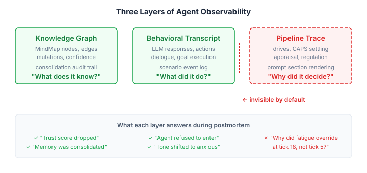
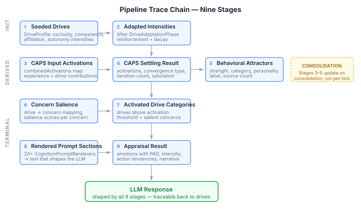
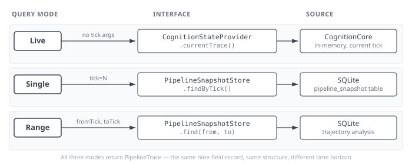

# Where the Why Lives

Most cognitive agent architectures have two layers of observability. You can see what the agent knows — its knowledge graph, memory store, confidence scores, entity relationships. And you can see what the agent does — its responses, actions, the behavioral transcript. What you almost never get is the layer between: the pipeline that transforms observation into behavior. Drives weighted by personality. CAPS attractors settling through constraint satisfaction. Appraisal mapping emotion to concern salience. Regulation strategies selected, fatigued, overridden. Twenty prompt sections rendering cognitive state into the text that actually shapes the LLM.

That middle layer is where the "why" lives. And it is invisible by default.

## 1. The Two Layers Everyone Builds

Knowledge graph observability is mature. GraphQL resolvers return node counts, edge statistics, confidence distributions, entity trajectories. Mutation tracking records every change to every node with timestamps and provenance. Snapshot stores persist keyframes for historical reconstruction. If a memory was consolidated, you can trace when it happened, what triggered it, and what the graph looked like before and after.

Behavioral transcript observability is equally straightforward. The agent produces text. You log the text. Scenario engines accumulate event streams — 300 ticks, 17 agents, every utterance timestamped and stored. The transcript tells you exactly what happened: who said what, who moved where, who reacted to whom.

Both are necessary. Neither answers the question that matters during a postmortem: *why did the agent produce this specific behavior at this specific tick?*

The knowledge graph tells you trust dropped for Agent X. It does not tell you whether that trust drop caused the avoidance behavior, or whether the avoidance was driven by a proactive regulation signal triggered by a shame memory from forty ticks ago. The transcript tells you the agent refused to enter the library. It does not tell you that the refusal came from the FOUNDATION phase of the cognitive pipeline, before appraisal even ran, because a proactive regulation participant matched the location context against a cached regulation episode with low effectiveness.

## 2. The Pipeline Nobody Instruments

A cognitive agent pipeline is not a function call. It is a multi-phase process where each phase modifies state that downstream phases consume:

Drives set the motivational context. CAPS settling resolves personality-weighted constraints into behavioral attractors. Appraisal maps incoming observations against active concerns and produces emotions with valence, arousal, and dominance. Regulation selects and applies strategies — cognitive change, response modulation, situation modification — modulated by personality and accumulated fatigue. Goal formation bridges emotional state to action tendencies. And finally, twenty-plus prompt renderers transform this entire state into the text sections that actually shape the LLM's response.

Each of these stages has internal state that is consumed and discarded. After the tick completes, the pipeline state is gone. All that remains is the knowledge graph (long-term) and the transcript (ephemeral). The computational trace — the chain of intermediate states that explains *why this behavior and not that* — evaporates.

**A fair objection: "Just log more."** But the pipeline stages are not independent outputs you can log in isolation. They form a causal chain. The appraisal result depends on which drives are active. Which drives are active depends on CAPS settling. CAPS settling depends on which experiences have been consolidated. The value of the trace is not any single stage — it is the chain. A trace that captures appraisal without capturing the drives that influenced it answers half a question.

## 3. Why Temporal Behavior Demands This

For single-tick agents — prompt in, response out — pipeline observability is a luxury. For agents with temporal behavior — systems that change across ticks through fatigue accumulation, monitoring feedback, regulation adaptation, personality-driven learning — it is a requirement.

Consider a fatigue model. An agent regulates emotion, and each regulation event accumulates fatigue. The spec says fatigue reaches the override threshold at tick 5. The actual system, running through a convergent geometric series where effort diminishes as fatigue grows, crosses the threshold around tick 20. The spec's model is linear. The implementation is a negative feedback loop. The numbers are correct at tick 1 and diverge from there.

A transcript will show you the strategy switch happened at tick 20. A knowledge graph will show you the fatigue value. Neither will show you the per-tick trajectory: the diminishing effort, the shrinking alpha, the convergent series that produces a timeline four times longer than the spec predicted. Only a pipeline trace — the full chain captured at every tick — reveals the dynamics.

Or consider an API gap where two components work perfectly in isolation and fail when connected through the pipeline. Component A writes regulation results with location context. Component B reads location context and generates avoidance goals. Both have unit tests that pass. But the pipeline never provides the location context — a null flows through the orchestrator, and both components silently do nothing with it. The knowledge graph shows no regulation episodes with location data (because none were ever written). The transcript shows no avoidance behavior (because the avoidance participant short-circuits on null context). The pipeline trace would show the null flowing from the orchestrator through both participants — the gap visible as a missing value at a specific stage.

## 4. The Architectural Challenge

Pipeline observability has a structural problem that graph observability does not: the pipeline spans multiple architectural layers. Drive orchestration, CAPS settling, appraisal, regulation, and prompt rendering live in different modules with different dependency hierarchies. An observability layer that queries all of them creates an upward dependency — reaching from a lower-layer module into higher-layer implementation code.

The solution is an SPI — a Service Provider Interface defined in the observability API layer, implemented by the pipeline orchestrator. The observability module knows *what to ask for* (a snapshot of pipeline state). The pipeline module knows *how to assemble it* (querying each participant's current state). The dependency flows downward: the implementation depends on the API, not the other way around.

One subtlety that only surfaces in practice: not all pipeline stages run per-tick. CAPS settling runs during consolidation — a periodic background process, not part of the tick pipeline. The attractors that influence per-tick behavior were computed during the last consolidation and stored in the knowledge graph. A pipeline trace needs to capture "what was the CAPS state when this tick ran," even though that state did not change during this tick. The trace is a snapshot of the cognitive background that produced the behavior, not a log of computations that happened during it.

## 5. What the Trace Actually Captures

The implementation centres on a single record — `PipelineTrace` — that captures the nine pipeline stages in one snapshot:

| Field | Source | What it tells you |
|-------|--------|-------------------|
| `appraisalResult` | `AppraisalTickParticipant` | Which emotion was appraised, its type (OCC taxonomy), intensity, action tendencies |
| `concernSalience` | `AppraisalTickParticipant` | Which concerns are active and how strongly — maps drive names to salience scores |
| `capsInputActivations` | `BehavioralSynthesisPhase` cache | What activation values entered CAPS settling — experience classifications plus drive intensities |
| `capsSettling` | `BehavioralSynthesisPhase` cache | How CAPS resolved: output activations, iteration count, convergence type, saturation ratio |
| `regulationResult` | `EmotionRegulationTickParticipant` | Which Gross strategy was selected, at what intensity, with what environmental directives |
| `channelWeights` | `AppraisalTickParticipant` | Barrett four-channel weights that shaped how emotion rendered into prompt text |
| `habituation` | `AppraisalTickParticipant` | Whether repeated exposure has dampened the emotional response |
| `activatedDriveCategories` | `CognitionCore` | Which drives exceeded their activation threshold this tick |
| `promptSections` | All `CognitionPromptRenderer` instances | The exact text the LLM received — every prompt section, keyed by block tag |

The last field is the most operationally useful. `promptSections` captures the rendered output of every cognitive prompt section — mood, drives, appraisal, behavioral attractors, narrative, strategy, goals, curiosity, search budget, attention, regulation. This is not metadata about what was rendered. It is the text itself. When you are debugging why an agent behaved a certain way, you can read the exact prompt context the LLM was operating under at that tick.

Three practical details that matter more than they sound:

**CAPS settling data reflects the last consolidation, not the current tick.** `CapsEngine.settle()` runs during consolidation — a periodic background process, not part of the tick pipeline. The attractors that shape per-tick behavior were computed when memories were last consolidated. `BehavioralSynthesisPhase` caches its last `SettlingResult` and input activations per agent. The trace captures "what was the CAPS background when this tick ran," not "what CAPS computation happened during this tick." This distinction is critical for interpreting the trace correctly: if CAPS data looks stale, it is — by design.

**The render loop degrades gracefully.** Not every pipeline stage is active in every configuration. An agent without regulation configured will have `null` for `regulationResult`. An agent without appraisal will have `null` for `appraisalResult` and empty `concernSalience`. Prompt sections with unresolvable optional dependencies are caught and skipped — the trace contains what the pipeline actually produced, not what it theoretically could produce. A partial trace is still a useful trace.

**CognitionStateProvider is an SPI on CognitionCore.** The observability module does not reach up into the pipeline implementation. It defines a `CognitionStateProvider` interface. CognitionCore implements it. The dependency flows downward — the same pattern used throughout the architecture to keep layer boundaries clean. No new coupling, no privileged access.

### Query Modes

The `pipelineDump` endpoint exposes three query modes through a single `@PlatformQuery` method:

**Live** — no tick arguments. Returns the current pipeline state from `CognitionStateProvider.currentTrace()`. This is in-memory, zero-cost, and reflects whatever the last tick produced. Use it during development or live debugging.

**Historical (single tick)** — pass `tick=N`. Returns the stored snapshot from `PipelineSnapshotStore.findByTick()`. The SQLite implementation persists every tick's trace as a JSON-serialized record with a unique constraint on `(tenant_id, agent_id, tick_number)`. Use it for postmortem analysis of a specific moment.

**Historical (range)** — pass `fromTick` and `toTick`. Returns all snapshots in the range, ordered by tick number. This is the trajectory query — the one that reveals dynamics like fatigue accumulation, drive adaptation curves, and regulation strategy switches over time. For a 300-tick scenario with 17 agents, that is 5,100 snapshots at roughly 2-5 KB each — 10 to 25 MB in SQLite. Small enough to persist routinely, large enough to be useful.

The tick counter is a monotonic `AtomicInteger` on CognitionCore, incremented at the end of each `tick()` call after the TERMINAL phase completes. Capture is conditional — if no `PipelineSnapshotStore` is wired, the trace is still available via the live query path but is not persisted.

## 6. What This Enables

Per-tick pipeline snapshots, persisted alongside the behavioral transcript, create a new class of diagnostic capability:

**Postmortem analysis.** When an agent behaves unexpectedly at tick 147, you can query the pipeline state at that tick and trace the causal chain: which drives were active, what the appraisal produced, whether regulation fired, what strategy was selected, and — critically — what prompt text was rendered to the LLM. The rendered prompt is the direct input to the LLM. If the prompt sections show "Regulation fatigue: 70% — capacity severely depleted," you know the LLM was operating under that contextual pressure, regardless of what the transcript shows.

**Tuning.** Adjusting personality parameters or regulation thresholds requires seeing their effect across the pipeline, not just at the output. A parameter change that increases suppression capacity should be visible as a shift in the predictor's strategy selection at stage 4, a change in the regulation result at stage 5, and a corresponding change in the emotional prompt section at stage 8. If you can only see the final output, you are tuning blind — making changes and hoping the trajectory moved in the right direction.

**Pipeline coherence validation.** The most interesting future use: eval tests that assert on pipeline trace content rather than behavioral outcomes. Given a shame-inducing observation, does the trace show elevated shame in the appraisal result, the correct CAPS attractor activation, the expected regulation strategy selection, and the corresponding prompt section? This is not testing what the agent *said* — it is testing whether the cognitive pipeline produced an internally coherent chain of reasoning. It separates "did the agent behave appropriately" (behavioral eval) from "did the pipeline produce this behavior for the right reasons" (cognitive eval).

The behavioral eval tells you whether the output is correct. The pipeline eval tells you whether the system's reasoning is correct. Both can pass independently. When they diverge — correct behavior for wrong reasons, or wrong behavior from correct reasoning — you have found something that no amount of transcript analysis would reveal.

This is not hypothetical. The next step is pipeline coherence eval tests that run full cognitive ticks with known observations and assert cross-stage consistency using LLM classification. A shame-inducing observation should produce elevated shame in the appraisal result, suppression-related CAPS attractor activation, RESPONSE_MODULATION selection in the regulation result, and suppression-related prompt sections. If any link in that chain breaks — shame was appraised but regulation selected the wrong strategy, or the right strategy was selected but the prompt section rendered something unrelated — the eval catches it. The infrastructure is built. The question is no longer whether to instrument the pipeline. It is whether the instrumented pipeline tells a coherent story.

---

*References: Bosse, T., Pontier, M. & Treur, J. (2010). A computational model based on Gross' emotion regulation theory. Cognitive Systems Research, 11(3), 211-230. Mischel, W. & Shoda, Y. (1995). A cognitive-affective system theory of personality. Psychological Review, 102(2), 246-268. Gross, J.J. (2015). Emotion regulation: Current status and future prospects. Psychological Inquiry, 26(1), 1-26.*
