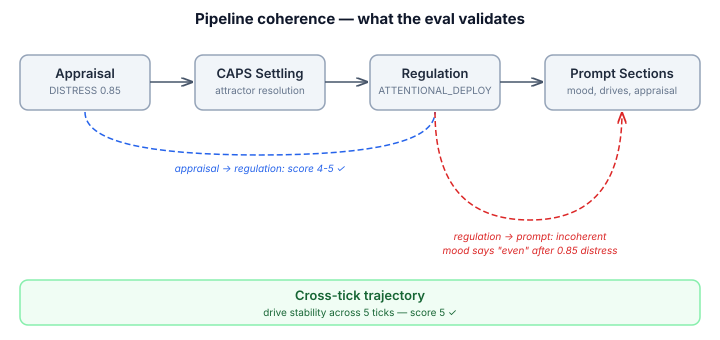
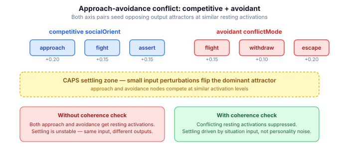

# When Pipeline Stages Disagree

The emotion regulation pipeline has three eval instruments. Drive expression eval scores what the agent *does*. Personality emergence eval scores whether the agent *stays in character*. Sleep derivation eval scores whether consolidation produces *coherent cognitive defaults*. All three measure behavioral outcomes — what comes out the end of the pipe.

None of them ask whether the pipe itself makes sense.

## Outcome validation isn't enough

A pipeline can produce correct behavior from an incoherent reasoning chain. An appraisal says "high-intensity distress," the regulation system selects attentional deployment as the safety response, the prompt reaches the LLM, and the character says something plausible. The behavioral eval scores it 4/5. Everything looks fine.

But the mood section of that same prompt says "you're feeling emotionally even." The drive section reports all motivations at baseline. The appraisal section says "overwhelming distress." These three prompt sections were computed independently, and two of them are wrong. The LLM compensates — it reads the appraisal narrative and infers the emotional state despite the contradictory signals. The output is passable. The pipeline is broken.

This is the difference between testing a calculator's answers and testing whether its intermediate computation steps are mathematically consistent. Both matter. The first catches wrong answers. The second catches right answers produced by wrong reasoning — answers that will stop being right when the inputs change.

## Cross-stage trace coherence

The pipeline captures a `PipelineTrace` at every tick: appraisal result, CAPS settling, regulation result, channel weights, drive categories, and rendered prompt sections. Each stage's output should be consistent with the stage before it. High-intensity fear appraisal → attentional deployment regulation → threat-focused prompt sections. That's a coherent chain.

The coherence eval runs a full cognitive tick with a known emotional state, captures the trace, and asks an LLM judge to score whether the stages agree with each other.

Four scenarios, each testing a different coherence relationship:

| Scenario | Coherence pair | Score |
|---|---|---|
| High distress (0.85) → safety gate | appraisal → regulation | 4 |
| High fear (0.9) → safety gate | appraisal → regulation | 5 |
| Moderate anger (0.5) → deliberate strategy | appraisal → regulation | 4 |
| Stable observation × 5 ticks | drive trajectory coherence | 5 |

Mean 4.5 against a gate of 4.0. The judge's reasoning on the distress scenario is worth reading in full: *"ATTENTIONAL_DEPLOYMENT is the psychologically predicted response to high-intensity DISTRESS (0.85) under Gross's process model — at this intensity, reappraisal is cognitively too costly, so the safety gate correctly selects attentional redirection; the 30% effectiveness and resulting 0.595 regulated intensity are plausible for distraction against strong affect, though the downstream prompt sections fail to reflect the still-elevated post-regulation distress, preventing a perfect score."*

The judge penalised not because the regulation was wrong — it was exactly right — but because the prompt sections downstream didn't reflect it. That's a genuine pipeline coherence gap, not a scoring artefact.

## Personality coherence in CAPS settling

The same session surfaced a second category of incoherence. The CAPS network settles regulation strategies from personality-derived resting activations. Each disposition axis contributes independently: competitive socialOrient seeds approach/fight/assert attractors. Avoidant conflictMode seeds flight/withdraw/escape attractors. When both are present on the same agent, both sets of attractors get elevated resting activations and the network becomes bistable — small input perturbations flip the dominant attractor.

The regulation predictor already had a specific guard for this: `hasCompetitiveAvoidantConflict()` falls through to LLM when personality signals conflict. But the CAPS network itself had no equivalent check. The resting activations were seeded unconditionally, and the connectionist settling was left to sort it out. On coherent personalities, it works well. On conflicting ones, it's a coin flip.

The fix is surgical: `detectApproachAvoidanceConflict()` identifies when approach-signaling axes (competitive socialOrient, bold riskAppetite) conflict with avoidance-signaling conflictMode (avoidant). When detected, output resting activations for the conflicting axes are suppressed — mediating nodes (tonic sensitivity) still apply, but behavioral attractors settle from situation input only. The personality still influences *how strongly* the system reacts (through BIS/BAS tonic sensitivity), just not *which direction* it jumps (through competing attractors).

## Where decisions come from

The third piece is accountability. The regulation tick participant selects strategies through a four-layer cascade: safety gate → CAPS settling → predictor → LLM. Each layer can pin a strategy or fall through to the next. The regulation result records what strategy was selected, but not *which layer selected it*. A suppression result from the safety gate (automatic, high-confidence) looks identical to a suppression result from the LLM (deliberate, contextual).

This matters for calibration. If personality-based predictions (the predictor layer) consistently produce lower effectiveness scores than LLM fallthrough for a specific agent, the personality→strategy mapping is miscalibrated for that character. Without source tracking, you can't detect this. The feedback loop now records `strategySource` alongside every regulation episode — SAFETY_GATE, CAPS, PREDICTOR, SHAME_CONTEXT, or LLM — and a query method groups effectiveness by source for per-agent comparison.

## Three kinds of validation

If you're building cognitive agents with multi-stage pipelines, you need three kinds of validation:

**Behavioral outcomes** — does the agent do the right thing? Drive expression eval, personality emergence eval. These are necessary but not sufficient.

**Pipeline coherence** — is the reasoning chain self-consistent? Cross-stage trace validation with LLM judges. Catches "right answer, wrong reasoning" before the reasoning fails on different inputs.

**Prediction calibration** — do the mechanical shortcuts actually outperform falling through to the LLM? Source tracking and outcome comparison. Without this, you're running a predictor on faith.

The first kind is what everyone builds. The second and third are what prevent the system from degrading silently as it scales.
